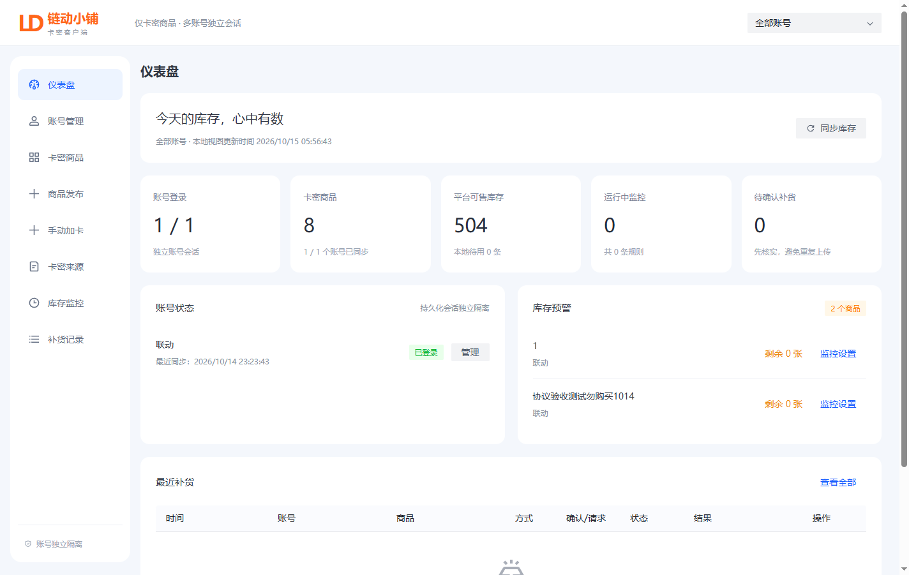
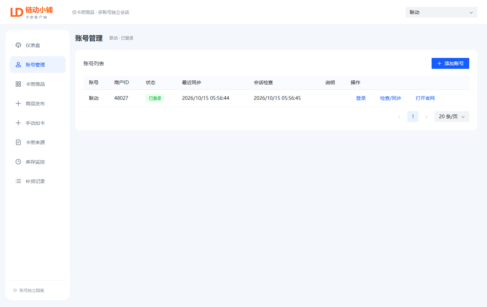
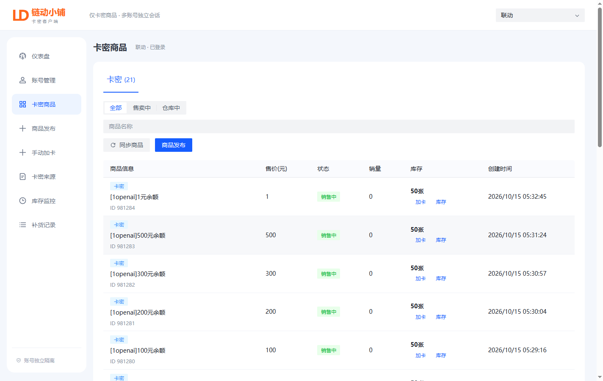
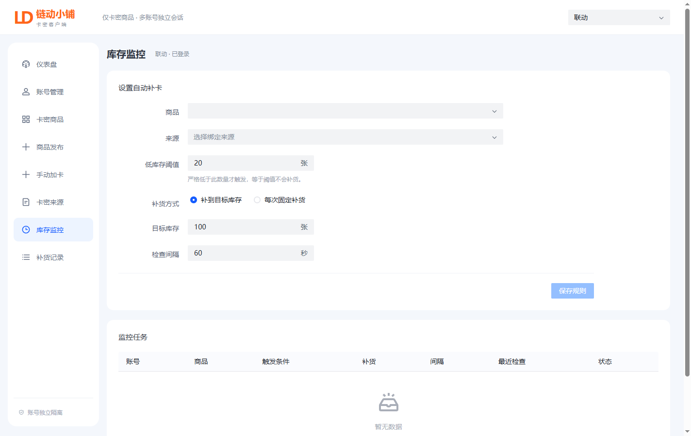

<div align="center">

<p><strong>简体中文</strong> | <a href="README.en.md">English</a></p>

<p><a href="https://github.com/linghungegeg/liandong-card-client/releases/latest/download/LiandongCard-v0.1.0-windows-x64-portable.zip"><strong>下载 Windows 绿色免安装版</strong></a> | <a href="https://github.com/linghungegeg/liandong-card-client/releases">版本发布</a></p>

# 链动卡密客户端

面向链动小铺商户的桌面卡密管理工具，让多账号管理、商品发布与自动补货更省心。

<p>
  <a href="LICENSE"></a>
  
  
  
  
  
  
</p>

多账号独立会话 · 卡密商品发布 · TXT / CSV / XLSX 导入 · 库存监控 · 自动补卡

</div>

---

<div align="center">
  <p><strong>广告推荐</strong></p>
  <p><strong>不降质GPT 满血claude调用：</strong> <a href="https://www.1openai.icu/">https://www.1openai.icu/</a><br />
  高质量 不掺水 物超所值  欢迎使用和测试</p>
  <p>后台-输入激活码即可使用</p>
</div>

---

## 项目介绍

链动卡密客户端基于 Electron 构建，将链动小铺的卡密商品管理集中到桌面端。你可以在一个窗口里切换商户账号、同步商品与库存、发布卡密商品、导入本地卡密，并按规则自动补货。

每个账号使用独立的持久化浏览器会话。业务请求在对应账号的官方页面环境中发起，复用官方登录态与请求封装；日常操作在客户端完成，需要登录验证时可以打开该账号的官网窗口。

项目专注于**卡密商品**，当前不包含订单、营销、分销、资金管理及云同步，无需另行部署业务后端或 Python 服务。本项目为第三方工具，与链动小铺官方无隶属关系。

## 功能一览

| 模块 | 功能 |
| --- | --- |
| 仪表盘 | 汇总当前或全部账号的登录状态、商品数量、平台库存、监控任务、库存预警及近期补货结果 |
| 账号管理 | 添加与切换账号、账号密码登录、会话检查、打开对应账号官网；不同账号会话独立保存 |
| 卡密商品 | 同步商品列表、查看商品详情与平台可售库存，支持筛选与分页 |
| 商品发布 | 填写卡密商品信息、上传图片、编辑富文本描述与使用说明，并核实发布结果 |
| 手动加卡 | 粘贴卡密或使用已导入来源，预览后提交，记录批次与实际接收结果 |
| 卡密来源 | 导入 TXT、CSV、XLSX，支持工作表、列选择、多列拼接及跳过表头，绑定账号与商品 |
| 库存监控 | 设置低库存阈值与检查间隔，选择固定数量补货或补到目标库存，按规则独立启停 |
| 补货记录 | 查看手动与自动补货批次，按账号和状态筛选、分页，对待确认结果重新核实 |

自动补货仅在平台库存**严格低于阈值**时触发，提交前再次检查库存与规则状态。同一账号的请求排队执行，同一商品的补货任务互斥处理；遇到登录失效、卡密不足或结果不明时，暂停受影响的监控。

## 软件截图

### 仪表盘

集中查看账号状态、平台库存、库存预警与近期补货情况。

<table>
  <tr><td></td></tr>
</table>

### 账号管理

按账号维护登录状态、同步时间与会话检查结果，需要时打开对应官网窗口。

<table>
  <tr><td></td></tr>
</table>

### 卡密商品

查看商品名称、售价、状态、销量与库存，从列表直接进入加卡与库存查看。

<table>
  <tr><td></td></tr>
</table>

### 库存监控

为商品绑定卡密来源，设置补货阈值、补货方式和检查间隔。

<table>
  <tr><td></td></tr>
</table>

## 快速上手

### 使用 Windows 免安装包

1. 获取 Windows x64 免安装 ZIP，解压到本地目录。
2. 双击目录中的 `LiandongCard.exe`。保留同目录的 `resources`、`locales`、DLL 等文件，不要只复制 EXE。
3. 在「账号管理」添加账号并登录；需要人工验证时，点击「打开官网」完成验证。
4. 在「卡密商品」同步商品；如需创建新商品，前往「商品发布」。
5. 在「卡密来源」选择账号与商品，导入文件，检查预览后保存。
6. 在「手动加卡」选择来源和数量提交；需要自动补货时，在「库存监控」保存规则并单独启用。
7. 在「补货记录」查看结果；遇到「待确认」批次，先重新核实再决定后续操作。

免安装包自带运行环境，无需安装 Node.js 或 Python。账号会话和本地数据保存在系统用户的应用数据目录中，不在 EXE 所在目录。

### 卡密导入说明

- **TXT**：一行一条卡密，导入时统计空行、重复与有效条数。
- **CSV / XLSX**：选择工作表、卡密列、多列拼接分隔符，以及是否跳过表头。
- **前导零**：卡号、密码建议在 Excel 中设置为文本；原文件已经丢失的前导零无法还原。
- **去重**：同一账号下按卡密内容去重，空行不计入有效卡密。
- **来源快照**：导入后保存内容快照，原文件不会被修改。文件新增内容后，需要重新选择并导入。

## 技术栈

以下版本对应当前 `package.json` 中锁定的依赖。

| 层次 | 技术 | 用途 |
| --- | --- | --- |
| 桌面运行时 | Electron 44.7.2 | 窗口、独立账号会话、文件选择及主进程能力 |
| 前端界面 | React / React DOM 19.3.0 | 页面渲染与交互 |
| 组件库 | Arco Design 2.66.18 | 表格、表单、弹窗、分页与消息提示 |
| 富文本编辑 | wangEditor 5.1.23 / React 适配 1.0.6 | 商品描述与使用说明编辑 |
| 本地存储 | Node.js 内置 `node:sqlite` | 账号、商品、来源、规则与批次记录 |
| 卡密加密 | Electron `safeStorage` | 本地卡密内容加密保存 |
| 表格解析 | `@e965/xlsx` 0.20.3 | CSV / XLSX 文件读取 |
| 前端构建 | Vite 8.3.4 | 开发服务与静态资源构建 |
| 桌面打包 | `@electron/packager` 20.3.0 | Windows x64 应用目录与 ASAR 打包 |
| 自动化测试 | Node.js 内置 `node:test` | 导入、补货、结果核实及回归测试 |

## 本地开发

### 环境准备

- Windows x64：当前打包脚本的目标平台。
- Node.js **22.13.0 或更高版本**，建议使用 Node.js 24；测试依赖内置 `node:sqlite`。
- npm：使用仓库中的 `package-lock.json` 安装依赖。
- 可正常访问链动小铺官网的网络，以及用于业务操作的商户账号。

在项目根目录执行：

```powershell
npm ci
npm run dev:desktop
```

`dev:desktop` 会启动 `http://127.0.0.1:5188` 开发服务与 Electron 桌面窗口，关闭客户端后停止开发服务。修改前端代码可通过 Vite 更新；修改 `electron/` 主进程代码后需要重启客户端。

单独执行 `npm run dev` 仅启动前端开发服务，浏览器预览不具备 Electron 的账号会话与 IPC 能力，完整业务操作需要在桌面窗口中进行。

### 常用命令

| 命令 | 作用 |
| --- | --- |
| `npm ci` | 按锁文件安装依赖 |
| `npm run dev:desktop` | 启动完整桌面开发环境 |
| `npm run dev` | 仅启动前端开发服务 |
| `npm run check` | 检查 Electron 主进程与业务模块语法 |
| `npm test` | 运行本地自动化测试 |
| `npm run build` | 构建前端到 `dist/` |
| `npm start` | 构建前端后启动 Electron |
| `npm run package` | 构建并打包 Windows x64 应用目录 |

### 独立数据目录

调试时可通过 `LIANDONG_DATA_DIR` 指定数据目录，避免与日常数据混用：

```powershell
$env:LIANDONG_DATA_DIR = Join-Path $env:TEMP "liandong-card-dev"
npm run dev:desktop
```

该变量同时影响数据库与账号会话目录。需要恢复默认路径时，在当前 PowerShell 中执行 `Remove-Item Env:LIANDONG_DATA_DIR`，再重新启动客户端。

## 构建与打包

仅构建前端资源：

```powershell
npm run build
```

输出到 `dist/`，不会生成桌面运行包。

检查并打包 Windows x64 客户端：

```powershell
npm ci
npm run check
npm test
npm run package
```

当前脚本使用 Electron Packager 与 ASAR，输出目录为：

```text
release/
└─ 0.1.0/
   └─ LiandongCard-win32-x64/
      ├─ LiandongCard.exe
      ├─ resources/
      ├─ locales/
      └─ ...
```

`npm run package` 生成完整应用目录，**不会自动生成 ZIP 或安装程序**。分发免安装版本时，应压缩整个 `LiandongCard-win32-x64/` 目录。当前脚本固定输出到 `release/0.1.0/`，该目录是构建产物，不随源码提交。

打包脚本排除了 `.runtime/`、`.research/`、`release/`、`tests/`、`scripts/` 与 `src/`。账号会话及数据库默认位于系统应用数据目录；分发时请使用干净的构建产物。

## 目录结构

```text
.
├─ electron/
│  ├─ main.cjs             # 应用入口、窗口与会话管理、IPC、文件导入
│  ├─ preload.cjs          # 向界面暴露受限业务接口
│  ├─ protocol.cjs         # 官方请求封装、发布字段与参数校验
│  ├─ stock.cjs            # 卡密解析、库存监控、补货及结果核实
│  └─ store.cjs            # SQLite 存储、账号隔离与批次记录
├─ src/
│  ├─ main.jsx             # React 页面、业务表单与交互
│  └─ style.css            # 客户端样式
├─ scripts/
│  ├─ dev.cjs              # Vite 与 Electron 联动启动
│  ├─ acceptance.cjs       # 真实业务验收脚本，涉及官方写入
│  ├─ review-check.cjs     # 桌面复检脚本
│  └─ package-smoke.cjs    # 打包应用启动检查
├─ tests/
│  ├─ core.test.cjs        # 核心业务测试
│  ├─ review-fixes.test.cjs # 补货、状态与分页回归测试
│  └─ fixtures/            # 测试用卡密文件
├─ img/                    # 软件截图、微信联系方式与赞赏码
├─ index.html              # 前端 HTML 入口
├─ package.json            # 项目信息、依赖与运行脚本
├─ package-lock.json       # 依赖锁文件
├─ .gitignore              # 本地数据与构建产物忽略规则
├─ LICENSE                 # MIT 开源许可证
├─ README.en.md            # 英文项目说明
└─ README.md               # 中文项目说明
```

`node_modules/`、`dist/`、`release/`、`.runtime/` 和 `.research/` 属于依赖、构建产物或本地调试资料，不纳入源码版本管理。

## 数据与运行说明

- **账号隔离**：每个账号使用独立的 `persist:liandong-<账号 ID>` 会话分区，业务数据按账号关联。
- **本地存储**：数据库为应用数据目录下的 `client.sqlite`，卡密内容使用系统 `safeStorage` 加密；系统加密不可用时拒绝保存卡密。
- **会话检查**：运行期间约每 5 分钟检查已登录账号的官方会话与商户身份。登录失效或身份变化会暂停对应监控，需重新登录并确认后恢复。
- **结果核实**：结合官方响应与卡密记录回读确认补货。超时、断网或进程中断产生的不确定结果保留为「待确认」，核实前不自动重复上传。
- **退出行为**：关闭主窗口即退出客户端并停止监控，自动补货需要保持软件运行。
- **窗口安全**：官方页面不开放 Node.js，保留 `webSecurity`，界面通过受限 IPC 调用业务能力。

## 常见问题

**为什么平台库存与本地卡密数量不同？**

平台库存是官方可售数量，本地卡密是尚未上传的来源库存，两者分别统计。官方没有返回库存时显示未知，不按零库存处理。

**为什么补货显示「待确认」？**

请求可能已经到达平台，但响应或回读尚未完成。请在「补货记录」重新核实，避免重复上传相同卡密。

**导入文件更新后会自动读取吗？**

不会。来源保存的是导入时的快照，需要重新选择文件并导入新增内容。

**免安装包可以连同数据复制到其他电脑吗？**

应用程序可以复制；数据默认在系统应用数据目录，卡密加密依赖系统环境，不能把跨电脑复制数据库当作受支持的数据迁移方式。

**支持 macOS、Linux 或后台常驻吗？**

当前打包脚本仅提供 Windows x64 目标，其他系统尚无对应交付说明；关闭主窗口会停止监控并退出。

## 反馈与贡献

欢迎提交问题反馈与改进建议。反馈时请附上软件版本、运行环境、复现步骤和必要截图，并遮盖账号凭据及真实卡密。

提交代码前建议运行 `npm run check`、`npm test` 和 `npm run build`。`scripts/acceptance.cjs` 涉及真实商品发布与加卡，仅应在明确授权的测试账号和测试内容上执行；本地测试通过不代表真实业务验收通过。

### 许可证

本项目采用 [MIT License](LICENSE) 开源，完整条款见 `LICENSE` 文件。

## 联系与支持

使用交流、问题反馈或合作咨询，可以扫描下方微信二维码。如果项目帮到了你，也欢迎自愿赞赏，支持后续维护。

<table align="center">
  <tr>
    <th align="center">微信联系</th>
    <th align="center">赞赏支持</th>
  </tr>
  <tr>
    <td align="center"></td>
    <td align="center"></td>
  </tr>
  <tr>
    <td align="center">扫码添加微信，交流使用问题</td>
    <td align="center">自愿赞赏，感谢支持</td>
  </tr>
</table>
